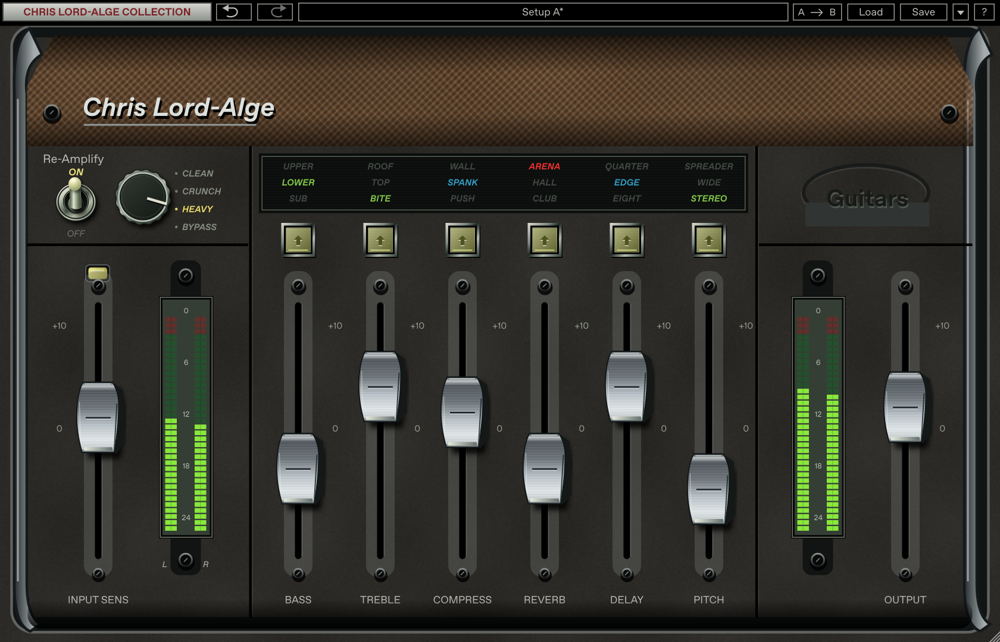
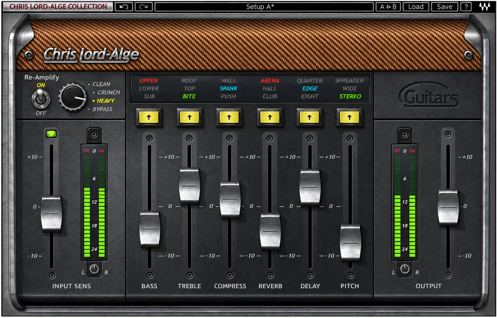

# Guitar Rack — C++ / JUCE VST3

Plugin independente para guitarra, inspirado no fluxo de controles das referências fornecidas. Alvo: **Windows 10/11 x64, VST3**. Não é um produto Waves, não inclui seus binários ou presets oficiais e não reproduz comprovadamente seus algoritmos. A interface é uma recriação desenhada em JUCE a partir das referências fornecidas.

## Compilar no Windows

Instale Visual Studio 2022 com **Desktop development with C++**, Windows SDK, CMake >= 3.22 e Git. No Developer PowerShell:

```powershell
cmake -S . -B build -A x64
cmake --build build --config Release --parallel 2
ctest --test-dir build -C Release --output-on-failure
```

O CMake obtém JUCE 8.0.6 fixado em commit. Alternativamente use `-DJUCE_PATH=C:/deps/JUCE`. Consulte a licença AGPL/comercial do JUCE antes de distribuir.

Resultado: `build/CLAInspiredGuitar_artefacts/Release/VST3/Guitar Rack.vst3`. Copie **a pasta inteira** para `C:\Program Files\Common Files\VST3\` e reescaneie na DAW. Também é gerado um aplicativo Standalone para testes. Interface e processamento aceitam entrada mono/estéreo e saída estéreo.

O workflow `.github/workflows/windows.yml` compila com MSVC x64, executa testes e disponibiliza a pasta VST3 como artefato. Foi executado com sucesso para Windows x64; veja o link de download no fim deste documento.

## Controles e presets

Input/Output e seis faders: −10 a +10. Re-Amplify: on/off; Clean, Crunch, Heavy, Bypass. Clique nos botões coloridos para alternar três modos; O menu ▾ ativa/desativa cada módulo. Os parâmetros estão expostos à automação da DAW. Os medidores exibem picos de entrada/saída e o LED de sensibilidade sinaliza o nível.

Load contém 60 presets originais (10 por categoria) em Acoustic, Clean, Crunch, Heavy, Lead / Solo e FX / Special. A seleção atualiza todos os controles públicos, sem parâmetros sonoros ocultos: os seis faders, seis seleções Color, seis estados On/Off, o modo do knob, Re-Amplify e Input/Output. Os 18 programas anteriores mantêm os índices, os ganhos e os estados originais; 42 programas novos completam o banco. Save grava XML, Load user preset recupera XML. O estado completo é salvo na sessão da DAW. Não há presets atribuídos a artistas convidados sem valores oficiais fornecidos.

## Implementação e limites de fidelidade

Re-Amplify usa saturação tanh e filtro de gabinete simples; Bass/Treble usam shelves; Compress usa envelope e ganho dependente do nível; Reverb usa quatro combs por canal; Delay usa taps e feedback filtrado; Pitch usa dois taps modulados com crossfade. As cores selecionam frequências, razão, tamanho ou tap conforme o módulo. Não há modelo de amplificador medido, IR de gabinete, oversampling, sincronismo de tempo da DAW ou pitch shifter de qualidade comercial.

As páginas do manual vieram em imagens de baixa resolução. Os nomes de Delay (Quarter / Edge / Eight) e as posições iniciais seguem a descrição visual fornecida pelo usuário. Frequências, tempos e regras exatas do LED ainda não foram confirmados em especificações técnicas do fabricante. Os valores internos são **aproximações próprias**, não especificações extraídas do original. A interface é desenhada em vetores com tecido procedural, metal, sombras e faders móveis; não é cópia pixel a pixel. Não existe processamento de áudio dentro das imagens geradas anteriormente.

## Validação

Teste do núcleo independente do JUCE:

```sh
cmake -S . -B build-dsp -DBUILD_PLUGIN=OFF
cmake --build build-dsp
ctest --test-dir build-dsp --output-on-failure
```

Testa bypass unitário, medidores, estabilidade dos efeitos/cores, cauda do delay e ganho de saída a 44.1, 48 e 96 kHz. O VST3 Windows x64 foi compilado com MSVC no GitHub Actions, e os testes DSP, empacotamento e upload passaram. [Baixe o artefato Guitar-Rack-Windows-x64-VST3](https://github.com/aulamix001/CLA-GUITARS/actions/runs/43800282515#artifacts) (login no GitHub necessário). O download contém o ZIP com a pasta VST3 completa. A compilação Linux também passou. Ainda são necessários testes manuais em DAW, automação, salvar/reabrir sessão, mono→estéreo, presets, redimensionamento e audição. Consulte `BUILD_STATUS.md` para o commit e a execução validados.

## Interface de referência e acabamento vintage



A captura foi gerada pelo editor real de JUCE a 1120 × 720; os níveis dos medidores foram injetados pelo teste de renderização. O editor mantém a proporção durante redimensionamento, com tecido marrom/dourado, chave metálica iluminada, knob de borda serrilhada, oito faders prateados escovados e sombras laterais. Seletores Color e valores iniciais seguem a descrição visual do usuário. A aparência foi recriada; não é comprovadamente idêntica pixel a pixel ao original.

A/B alterna dois estados; ▾ copia o estado ao outro slot, restaura os ajustes de referência e ativa/desativa módulos. Undo/Redo restaura parâmetros. Histórico e slots A/B vivem durante a sessão do editor; o estado de áudio ativo continua sendo salvo pela DAW. Os medidores L/R usam picos independentes de cada canal. Nenhum efeito de áudio foi substituído por uma imagem estática.

Para reproduzir a captura e os testes de interação no Linux:

```sh
cmake -S . -B build-ui -DJUCE_PATH=/caminho/para/JUCE -DBUILD_UI_PREVIEW=ON -DCMAKE_BUILD_TYPE=Release
cmake --build build-ui --target RackPreview
./build-ui/RackPreview_artefacts/Release/RackPreview /tmp/guitar-rack-ui.png
```

O teste exercita Color, Undo, Redo e troca/restauração A/B antes de renderizar o editor.

### Imagem de direção visual



Esta imagem gerada é uma referência de acabamento, não uma captura do VST3 e não está embutida como interface. A captura `docs/interface.png` acima mostra a interface realmente implementada. A referência inclui os acabamentos e o emblema Waves solicitados; a interface JUCE ainda apresenta diferenças visuais e não é indistinguível do produto original.

## Banco de 60 presets

Cada categoria contém 10 presets originais. O menu Load aplica automaticamente os controles, enquanto a DAW enxerga os 60 programas. A pasta `Presets/` contém os mesmos 60 ajustes em XML para Load user preset. `presets.csv` documenta cada valor de fader, Color, On/Off, modo, Re-Amplify e ganhos. O ZIP Windows inclui o VST3, os XMLs e a tabela.

Não há parâmetros de efeito ocultos, efeitos novos ou cópia de presets oficiais. Os novos nomes são sugestões de uso; a resposta depende do sinal de entrada e ainda não houve audição comparativa em DAW. O modo Pitch é o detune/doubling já implementado, sem mudança de oitava.

`preset_tests` carrega todos os 60 programas, verifica as seis categorias com 10 itens, mapeamento dos controles, limites, restauração de sessão e estabilidade do processamento estéreo. Esse teste é executado por CTest tanto no Linux quanto no workflow Windows. Para reexportar os XMLs e a tabela a partir do banco C++: `preset_tests /caminho/absoluto/Presets`.
